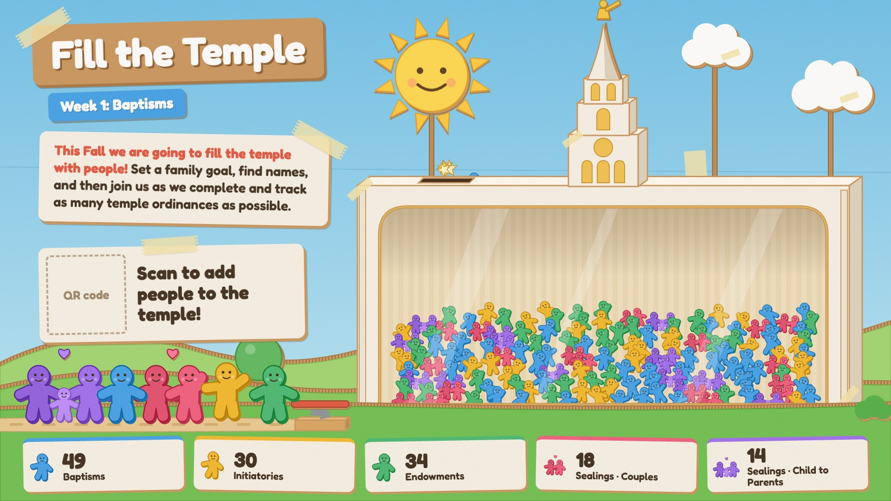
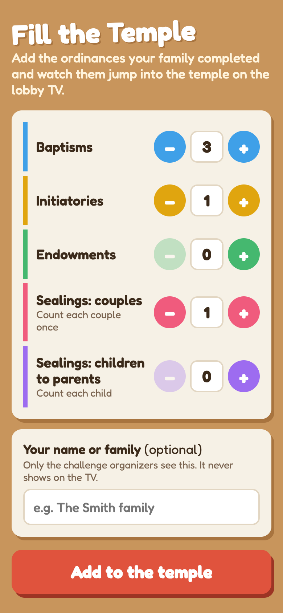

# Fill the Temple

A lobby TV display for a ward temple challenge. Cardboard paper-doll figures run, bounce off a springboard, and drop
through a coin slot into a cutaway temple that fills up as families report ordinances: baptisms, initiatories,
endowments, and sealings of couples and of children to parents. Families report from their phones by scanning a QR
code on the TV.





## How it fits together

One Cloudflare Worker serves everything from one address, on Cloudflare's free plan:

| Path | What it is |
| --- | --- |
| `/` | Phone form people reach by scanning the QR code ([public/index.html](public/index.html)) |
| `/tv` | Lobby display ([public/tv.html](public/tv.html)) |
| `/admin` | Organizer page: every submission with names, delete mistakes, download CSV, set the goal ([public/admin.html](public/admin.html)) |

[src/worker.js](src/worker.js) stores submissions in a SQLite-backed Durable Object. The TV holds a WebSocket to it:
each new report arrives as an animation, and a deletion makes the TV redraw from the new totals. Names are optional,
go to the admin page only, and never appear on the TV. Each submission is capped at 99 per ordinance type, and a
retried submission is only counted once.

**The goal** sets how many ordinances fill the temple, and the TV sizes the figures to match. Lower it on the admin
page and the figures get bigger, so the temple looks fuller; raise it and they shrink to make room. Submissions are
never changed, and open TVs reload themselves with the new goal. The minimum is 75; below that the figures hit their
maximum size.

<br clear="right">

## Deploying your own

1. Create a free Cloudflare account at https://dash.cloudflare.com/sign-up, then open **Workers & Pages** once so
   Cloudflare creates your `workers.dev` subdomain.
2. `npm install`, then `npx wrangler login`.
3. `npx wrangler secret put ADMIN_KEY` and enter a long passphrase. This is the password for `/admin`.
4. `npm run deploy`. It prints your site's address, like `https://fill-the-temple.<your-subdomain>.workers.dev`.
5. Open `<your site>/tv` on the lobby computer. The QR code points at your site automatically.

Before launch, set the goal on `/admin`, and check the weekly focus dates (the `start` option below) and the intro
text in [public/tv.html](public/tv.html).

## Running locally

```bash
npm install
npm run dev
```

Then open http://localhost:8787/tv and http://localhost:8787 side by side. Create a `.dev.vars` file (gitignored)
containing `ADMIN_KEY=local-dev-key` for the local admin page. Local data lives in `.wrangler/`.

## TV options

| Param | Default | What it does |
| --- | --- | --- |
| `goal` | `300` | Ordinances needed to fill the temple. When served, the goal set on the admin page wins |
| `form` | the site's own `/` | URL the QR code points to |
| `start` | `2026-11-01` | Date week 1 begins (drives the weekly focus tag) |
| `week` | none | Force a week (1–4) for previewing |
| `demo` | off when served, on when opened as a file | `?demo=1` adds random local-only submissions |

Demo keys (local only, nothing is saved): `1`–`5` send one of each type, `0` a random submission, `9` a big batch.

```js
templeChallenge.submit({ baptism: 3, initiatory: 1, endowment: 2, sealCouple: 1, sealChild: 0 }); // animate new ordinances
templeChallenge.setCounts({ baptism: 40, /* ... */ });                                           // load totals without animation
```

## Lobby computer: Raspberry Pi 4

Built and measured on a Raspberry Pi 4 (8 GB) running Raspberry Pi OS with desktop, on the HDMI port next to the
USB-C power. Flash it with Raspberry Pi Imager, setting a username and password, the wifi, and SSH. Then, on the Pi:

```bash
wget -O pi-setup.sh https://<your-site>/pi-setup.sh
bash pi-setup.sh https://<your-site>
```

[public/pi-setup.sh](public/pi-setup.sh) opens `/tv` in Chromium kiosk mode at login (keeping the Pi's taskbar and
desktop underneath), turns off screen blanking, sets HDMI to 1080p at 60Hz, and turns off wifi power saving, which
dropped a Pi off the network in testing. It's safe to run again. Reboot afterwards.

The TV page is tuned for a Pi:
- **The scene holds still between moments.** Any motion inside one big SVG makes a slow computer re-process the whole
  scene, so idle waves are rare, and the sun, clouds, trees and Moroni move on their own compositor layers instead.
- **Settled dolls are baked into a canvas.** Each doll is ~60 shapes, so a full temple was 20,000 live shapes.
- **Figures run in one at a time, at 30fps,** and the paper texture uses a normal blend, not multiply.
- **Chromium runs with `--disable-gpu-rasterization`,** because the Pi 4's graphics chip chokes on many moving shapes.

On a Pi 4 that's a steady 60fps idle and ~50fps while a family of 10 runs in.

**Church wifi splash page:** if the TV shows the splash page or "Reconnecting…", press Alt+F4 to close the kiosk,
open the web browser from the Pi's menu, accept the splash page, and reboot.

**Remote help (optional):** [Tailscale](https://tailscale.com) lets you SSH into the Pi from anywhere once it's past
the splash page. Start it with `sudo tailscale up --accept-dns=false`, so it doesn't interfere with the splash page.

## Nightly backup to Google Drive

[backup/drive-backup.gs](backup/drive-backup.gs) is a Google Apps Script that runs in your own Google account. Every
evening, if anything changed, it downloads the CSV from `/api/admin/export.csv` with the admin password and saves it
in a Drive folder called "Fill the Temple backups". Setup steps are at the top of the file. If you change the admin
password, update it in the script too.
